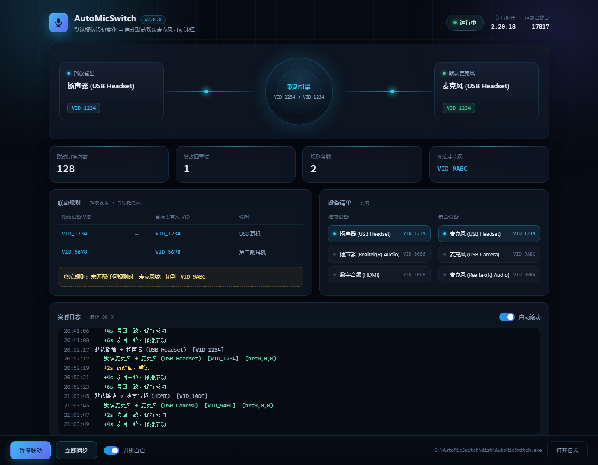

# AutoMicSwitch

> 切换 Windows 默认播放设备（耳机 / 音箱）时，自动把默认麦克风切到对应设备。附带一个本地网页控制台。

**AutoMicSwitch** watches your Windows default playback device and automatically switches the default microphone to the matching one — so when you put on your headset, the headset mic becomes default; when you switch to speakers, the camera mic takes over. Ships with a local web dashboard. No third-party dependencies.

[](LICENSE)
[](#运行环境)
[](#运行环境)
[](#运行环境)
[](#)

作者：沐辉 ｜ MIT License ｜ .NET Framework 4.x，无第三方依赖

---

## 目录

- [解决的问题](#解决的问题)
- [界面](#界面)
- [功能](#功能)
- [运行环境](#运行环境)
- [安装](#安装)
- [配置 rules.txt](#配置-rulestxt)
- [控制台](#控制台)
- [托盘菜单](#托盘菜单)
- [开机自启](#开机自启)
- [自动更新](#自动更新)
- [从源码编译](#从源码编译)
- [发版](#发版)
- [目录结构](#目录结构)
- [日志](#日志)
- [工作原理](#工作原理)
- [常见问题](#常见问题)
- [卸载](#卸载)
- [路线图](#路线图)
- [贡献](#贡献)
- [致谢](#致谢)
- [License](#license)

## 解决的问题

同时插着耳机、音箱、摄像头时，Windows 只认一套默认输入和输出。戴耳机开麦想用耳机麦，切到外放又得手动把麦克风换成摄像头麦，每次都要去声音设置里点两下。

这个程序常驻后台盯着默认播放设备，一旦变化，就按规则把默认麦克风一起切过去（通信麦克风也会设）。设备用硬件路径里的 `VID_xxxx` 识别，换 USB 口、改显示名、重装驱动都不会失效。

## 界面



## 功能

- 默认播放设备变化 → 自动切换默认麦克风
- 本地网页控制台：信号流向、当前设备、规则表、设备清单、实时日志
- 控制台里点一下设备就能切默认播放 / 录音设备，不用再翻系统声音设置
- 托盘常驻，可暂停 / 恢复、打开日志
- 安装时可选开机自启，装完也能在控制台里随时开关
- 内置更新：查到新版本后下载、校验、静默替换并自动重启
- 规则写在 `rules.txt`，改完重启程序即可，不用重新编译

## 运行环境

- Windows 10 / 11（更老的系统理论可用，没测过）
- .NET Framework 4.x，系统自带，不用另外装
- 不需要管理员权限

## 安装

下载 `AutoMicSwitch-Setup.exe` 双击运行，装到 `%LOCALAPPDATA%\AutoMicSwitch`，不写系统目录，全程不需要管理员权限。

安装时可勾选：

- 开机自动启动（默认勾选）
- 创建桌面快捷方式（默认勾选）
- 安装完成后立即运行（默认勾选）

装完从开始菜单或桌面图标启动，浏览器会自动打开控制台 http://127.0.0.1:17817/。带 `--startup` 启动时只驻留托盘，不弹浏览器。

> 项目只提供安装版。装到固定目录是为了让开机自启的路径稳定，更新时也能整包替换。

批量部署想静默装：

```
AutoMicSwitch-Setup.exe /S            静默安装，装完不启动
AutoMicSwitch-Setup.exe /S /relaunch  静默安装并启动
```

## 配置 rules.txt

`rules.txt` 放在程序目录里（安装版是 `%LOCALAPPDATA%\AutoMicSwitch`），控制台底部的「打开目录」能直接跳过去。安装包会放一份示例进去。一行一条规则，格式是：

```
播放设备关键字|目标麦克风关键字|说明
```

`说明` 可以省略。关键字匹配的是设备硬件路径（InstanceId）的子串，一般写 `VID_xxxx` 就够。以 `#` 开头的行是注释。

兜底规则最多写一条，播放设备没匹配到任何规则时用它：

```
fallback=VID_9ABC     # 没匹配到时，麦克风切到这个设备
fallback=none         # 没匹配到时，什么都不做
```

一个完整的例子：

```
# 两副耳机各自用自己的麦克风
VID_1234|VID_1234|USB 耳机
VID_5678|VID_5678|第二副耳机

# 音箱 / HDMI / 板载输出一律用摄像头麦
fallback=VID_9ABC
```

程序在每次启动时读一次 `rules.txt`，改完重启程序生效。文件不存在或者没写任何规则时，程序不会改动任何设备（控制台会显示「未配置规则」）。

### 怎么查 VID

设备管理器 → 选中设备 → 右键「属性」→「详细信息」→ 在「属性」里选「硬件 Id」，会看到类似 `USB\VID_1234&PID_5678&MI_00` 的字符串，取 `VID_1234` 就行。

音频端点用的是它所在声卡的 VID，所以一副 USB 耳机的播放端和录音端通常是同一个 VID。

### 关键字写得更精确一点

关键字是子串匹配，`VID_1234` 会命中所有含这串的设备路径。如果同一台机器上有两个设备共用一个 VID（比如同一颗声卡下的多个接口），可以在关键字里带上后面的部分，例如 `VID_1234&PID_5678&MI_02`，匹配就更准。

注意有些主板和音箱会枚举出一个没有拾音孔的假麦克风端点，别把规则指到它上面。

## 控制台

浏览器打开 `http://127.0.0.1:17817/`，页面每秒自动刷新一次。

- **顶部**：运行状态（运行中 / 已暂停）、程序运行时长、控制台端口
- **信号流向**：左边是当前默认播放设备，中间是联动引擎（显示这次匹配到的规则，走兜底规则时会亮一个黄色标记），右边是当前默认麦克风。发生切换的瞬间，左右两个节点和中间的引擎会闪一下
- **指标**：联动切换次数、被改回重试次数、规则条数、兜底麦克风
- **联动规则**：当前 `rules.txt` 解析出来的规则表
- **设备清单**：当前在线的播放设备和录音设备，默认设备会高亮。**点任意一台就把它切成系统默认**，播放设备改完，联动规则会在下一轮自动跟上
- **实时日志**：最近 80 条，按级别着色（普通 / 成功 / 警告 / 错误），可以关掉自动滚动
- **底部操作栏**：暂停 / 恢复联动、开机自启开关、检查更新、打开目录、打开日志

## 托盘菜单

右键托盘图标：

- 打开控制台
- 暂停联动 / 恢复联动
- 开机自启（勾选项）
- 检查更新
- 打开日志
- 打开程序目录
- 退出

双击托盘图标直接打开控制台。

## 开机自启

三种方式，效果一样：

1. 安装时勾选「开机自动启动」
2. 控制台底部勾选「开机自启」
3. 托盘菜单里勾「开机自启」

写的是 `HKCU\Software\Microsoft\Windows\CurrentVersion\Run` 下的 `AutoMicSwitch`，值形如 `"完整路径\AutoMicSwitch.exe" --startup`。任务管理器 →「启动应用」里能看到同名条目。

程序每次启动会对一遍这条记录：路径和当前 exe 对不上（比如换过安装位置）就自动改过来，不会出现自启指向旧目录的情况。

带 `--startup` 启动时不开浏览器，只驻留托盘。

## 自动更新

程序启动一分钟后查一次，之后每小时一次；托盘菜单点「检查更新」也可以手动查。

版本信息读的是 GitHub Release 里的 `latest.yml` 直链（`releases/latest/download/latest.yml`），不调 API，也就没有频率限制。查到新版本后：

1. 控制台版本号变黄，底部按钮变成「下载 vX.Y.Z」
2. 点一下开始下载安装包，下完用 `latest.yml` 里的 sha512 校验
3. 校验通过后按钮变成「重启并更新」，点了就退出、静默安装、自动重新启动

直连 GitHub 不通时会自动按常见本机代理端口（7890 / 7897 / 10809 / 1080 / 8118）逐个重试，都没通则提示去 GitHub 手动下载。走通的那条线路会记下来，后面直接用，不用每次都等直连超时一轮。

## 从源码编译

`build.cmd` 用系统自带的 C# 编译器，不需要 Visual Studio。跑完产出 `dist\AutoMicSwitch-Setup.exe`。

分三步：先用 `tools\IconGen.cs` 生成 `app.ico`，再编译主程序到 `dist\tmp\AutoMicSwitch.exe`（控制台页面和规则示例都是编译时嵌进去的），最后把主程序当资源编进安装包。主程序 exe 只是安装包的素材，不单独对外。

在 Git Bash 里直接调 csc 的话，选项要改用 `-` 前缀（`-nologo`、`-target:winexe` 等），否则会被当成路径转换；跑 `build.cmd` 本身没这个问题。

改完代码重新跑一次即可。注意正在运行的程序会占着文件，重编前先退出。

## 发版

```
pack-release.cmd
```

先跑一遍 `build.cmd`，再生成 `dist\latest.yml`（版本、大小、sha512、更新说明取自根目录的 `release-notes.md`）。

发版时把这两个文件传进同一个 GitHub Release：

| 文件 | 作用 |
| --- | --- |
| `dist\AutoMicSwitch-Setup.exe` | 资产名必须叫这个，客户端按名字取 |
| `dist\latest.yml` | 客户端靠它比版本、核 sha512 |

版本号只在 `src\AssemblyInfo.cs` 里维护一处，程序里显示的、安装记录里的、`latest.yml` 里的都从它来。

## 目录结构

```
src/
  Program.cs        入口、托盘菜单、控制台 API
  AudioEngine.cs    联动引擎：设备枚举、规则匹配、切换与校验
  HttpServer.cs     本地 HTTP 服务与 JSON 输出
  Updater.cs        在线更新：版本比对、下载校验、交给安装包替换
  Setup.cs          安装 / 卸载（主程序作为资源嵌在里面）
  AssemblyInfo.cs   程序集信息，版本号唯一来源
  Dashboard.html    控制台页面（编译时嵌入 exe）
tools/
  IconGen.cs        构建期生成多尺寸 app.ico
  PackRelease.cs    构建期生成 Release 用的 latest.yml
build.cmd           一键编译，产出安装包
pack-release.cmd    编译 + 生成 latest.yml
rules.example.txt   规则示例
release-notes.md    更新说明，发版时写进 latest.yml
docs/               界面预览页与截图
```

## 日志

日志写在 exe 同目录的 `AutoMicSwitch.log`，UTF-8 文本，记事本能直接看。每次切换都有记录：

```
2026-01-02 20:52:17 默认播放 → 扬声器 (USB Headset)  [VID_1234]
2026-01-02 20:52:17    默认麦克风 → 麦克风 (USB Headset)  [VID_1234]  (hr=0,0,0)
2026-01-02 20:52:19    +2s 读回一致，保持成功
2026-01-02 20:52:21    +4s 读回一致，保持成功
2026-01-02 20:52:23    +6s 读回一致，保持成功
```

超过 512 KB 会自动清空重来，不用手动维护。

## 工作原理

- 每 0.7 秒用 MMDevice API（`IMMDeviceEnumerator::GetDefaultAudioEndpoint`）读一次默认播放设备
- 发现变化后按规则找到目标麦克风，用 `AudioSes.dll` 里未公开的 `IPolicyConfig::SetDefaultEndpoint` 设为默认。`eConsole` / `eMultimedia` / `eCommunications` 三个角色一起设，效果等同于手动在设置面板里选
- 设置完在 2 / 4 / 6 秒各读回校验一次，被别的程序改回去会自动重试并记日志
- 控制台是本地 `TcpListener` 绑 `127.0.0.1`，端口默认 17817，被占用时自动往后找。页面嵌在 exe 里，不联网、不上传任何数据
- 单实例运行，靠命名互斥量避免重复启动

## 常见问题

**麦克风切完几秒又被改回去**

有别的音频软件在抢默认设备。日志里会连着写「被改回，重试」，找出那个软件关掉它的开机自启即可。常见的有各类耳机 / 鼠标的驱动中心、带音频管理的笔记本厂商工具。

**播放设备变了，麦克风没动**

看日志：

- 写「该播放设备无规则且未设兜底」→ 这个设备不在 `rules.txt` 里，加一条规则，或者设个 `fallback`
- 写「找不到含 xxx 的麦克风」→ 目标麦克风当前不在线（耳机没插、摄像头没通电），或者 VID 写错了

**控制台打不开**

先看日志里「控制台已就绪 → http://127.0.0.1:xxxxx/」这一行，端口可能不是 17817。如果这行是「控制台启动失败」，多半是本机安全软件拦了本地监听，把程序加进白名单即可。联动功能和控制台是分开的，控制台挂了不影响切换。

**换了 USB 口 / 改了设备名，要重新配吗**

不用。匹配用的是硬件路径里的 VID，跟插哪个口、显示叫什么名字无关。

**规则不生效**

- 确认 `rules.txt` 和 exe 在同一个目录
- 确认关键字是设备硬件 Id 里的子串，大小写不敏感
- 改完规则要重启程序

**想临时停一下**

控制台点「暂停联动」，或托盘菜单选「暂停联动」。暂停期间只停止切换，程序还在跑。

**会联网吗**

不会。控制台只监听 `127.0.0.1`，外部访问不到，程序本身也不发任何请求。

**支持多用户 / 远程桌面吗**

程序按当前登录用户运行，自启写在 `HKCU` 下，只对当前用户生效。远程桌面切换会话时默认设备可能变化，程序会按规则重新匹配。

## 卸载

三种方式，效果一样：

1. Windows「设置 → 应用 → 已安装的应用」里找到 AutoMicSwitch，点卸载
2. 开始菜单里 AutoMicSwitch 目录下的卸载入口
3. 直接跑 `%LOCALAPPDATA%\AutoMicSwitch\Uninstall.exe`

卸载会先停掉正在运行的进程，再删掉程序文件、快捷方式、开机自启和卸载登记。安装目录里的 `rules.txt` 和日志会一并删除，要留的先备份。

不改动驱动和服务，删完就是彻底卸载。想静默卸载用 `Uninstall.exe /uninstall /S`。

## 路线图

- [ ] 支持「播放设备 → 同时切换多个输入设备」
- [ ] 控制台内直接编辑规则并热重载，不用重启
- [ ] 规则支持按设备显示名匹配（除 VID 外）

有想法欢迎提 Issue 一起讨论。

## 贡献

欢迎 Issue 和 PR。参与前请留意：

1. 提交 Issue 时尽量附上 `AutoMicSwitch.log` 里的相关日志、Windows 版本，以及设备管理器里对应设备的硬件 Id
2. 提交 PR 请保持「零第三方依赖、单文件编译」的既有风格，能通过 `build.cmd` 编译即可
3. 代码注释用中文，与现有风格保持一致
4. 涉及行为变更的改动，请同步更新本 README 与 `rules.example.txt`

## 致谢

- 感谢 Windows Core Audio（MMDevice）与 `IPolicyConfig` 相关公开资料的整理者
- 控制台视觉参考了常见的深色数据面板风格

## License

[MIT](LICENSE) © 2026 沐辉
